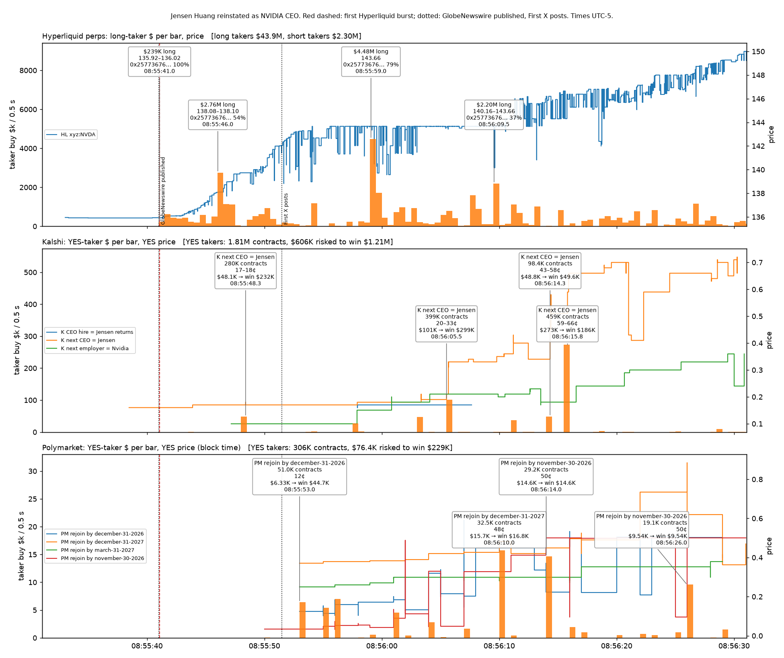
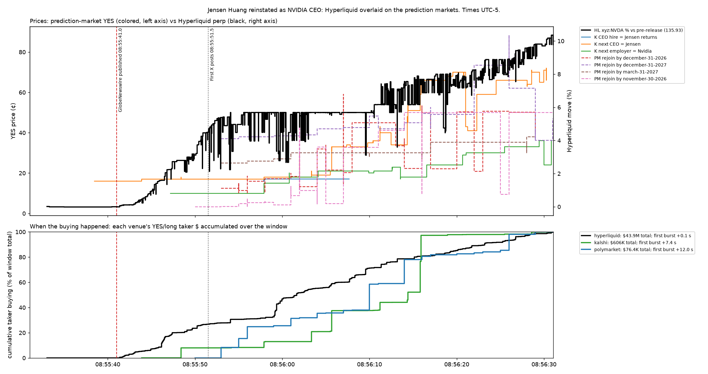

# Jensen Huang reinstated as NVIDIA CEO: who clicked first?

*Event: 2026-11-23, NVIDIA release published on GlobeNewswire at 8:55:41 AM ET (the page displays "08:55 ET"). Evidence: [`notebooks/jensen.ipynb`](../notebooks/jensen.ipynb). All times ET.*

## Summary
- **The release went out at 8:55:41, not 8:55:00.** GlobeNewswire's page shows only the minute; its metadata carries the second. The ~41 s "gap" between the 8:55 stamp and the first trades was that rounding.
- **Hyperliquid reacted in the same second.** Wallet [`0x25773676902085225ae5751075e4161369334897`](https://app.hyperliquid.xyz/explorer/address/0x25773676902085225ae5751075e4161369334897) swept the `xyz:NVDA` ask at 8:55:41.362 and bought $2.96M in the first 10 s. GlobeNewswire publishes only to the second, so whether the sweep came a few hundred ms before or after publication can't be told.
- **Kalshi followed 7.4 s after the release** with 280,157 YES at 17–18¢ on "next CEO = Jensen" (8:55:48.399). HL NVDA was already up about 2% by then.
- **X was slower than both.** First posts 8:55:51.5 per PM Pulse (+10.5 s; post not identified); the earliest post we could verify is @DeItaone at 8:56:16.1 (+35 s).
- **Polymarket's first burst landed at 8:55:53** (50,980 YES at 12.4¢), 12 s after the release. One small fill came earlier: 1,030 YES at 3.3¢ ($34) on Nov 30 at 8:55:50 (+9 s). Both are block times; the actual matches were ~1–3 s earlier.
- **Kalshi's 7.4 s is its first real reaction, not its first fill.** Two small YES fills printed at 8:55:43.9–44.0 (+2.9 s, $262 together at 17¢), but that market printed 9 fills in the 101 s before the release, so they can't be told apart from background trading.
- **The Hyperliquid data matches Hyperliquid's own API exactly** (section "Is the Hyperliquid data right?"). The one inferred piece, which side was the taker, agrees with Hyperliquid's own flag on 94.4% of checked fills and on 100% around the first burst.
- **HL didn't front-run the news; it was the fastest reader of it.** Whether Kalshi's takers trade off HL or off the wire can't be told from one event: either way they were 7 s behind. Separating the two needs a set of events (see Next steps).



Each callout is one burst: size, price range, cash risked → payout at $1 (binaries), or long notional and the top wallet's share (HL). Panel titles carry the window totals. Kalshi's callouts line up with the PM Pulse chart (280K at 17–18¢, 459K at 59–66¢). Their 389K at 21–33¢ shows here as 399K at 20–33¢ because the 0.5 s buckets are cut differently.



The same window on one plot. Top: YES prices (colored, ¢) against HL `xyz:NVDA`'s % move from its last pre-release print (black). Bottom: each venue's taker buying accumulated as a % of its own window total, which compares when each venue bought regardless of size. HL leaves the floor in the release second; Kalshi's and Polymarket's first bursts come with HL already up 2.8% and 5.4%. Full window (8:54–8:58): [`figures/jensen-overlay-full.png`](figures/jensen-overlay-full.png).

## When did the release actually go out?
GlobeNewswire's page shows "November 23, 2026 08:55 ET". Its `og:article:published_time` and JSON-LD `datePublished` say **2026-11-23T13:55:41Z**. NVIDIA's other GlobeNewswire releases show how to read that:

| Release | Published (ET) | Kind |
|---|---|---|
| Q3 earnings | 11-17 16:20:00 | scheduled |
| Financial community event | 11-19 17:00:00 | scheduled |
| Three product releases | 11-16 11:00:00 | scheduled |
| Board statement | 11-10 14:07:46 | unscheduled |
| CEO transition | 11-12 08:48:12 | unscheduled |
| **Jensen reinstated** | **11-23 08:55:41** | unscheduled |

Scheduled releases land exactly on :00; unscheduled ones carry the second they were pushed. So 8:55:41 is the real send time. NVIDIA's newsroom RSS and its IR site both show the release at 8:55:00, the minute only.

| ET | Source | After the release |
|---|---|---|
| 8:55:41 | GlobeNewswire publishes | 0 |
| 8:55:41.362 | HL `xyz:NVDA` sweep | same second |
| 8:55:48.399 | Kalshi first burst | +7.4 s |
| 8:55:50 | Polymarket first fill, $34 (block time) | +9 s |
| 8:55:51.5 | First X posts (PM Pulse) | +10.5 s |
| 8:55:53 | Polymarket first burst (block time) | +12 s |
| 8:56:16.132 | X @DeItaone | +35 s |
| 8:57:54 | EDGAR 8-K accepted | +2 m 13 s |
| 8:58:03.139 | X @nvidianewsroom | +2 m 22 s |

X times are decoded from post ids, which embed the creation time in ms. GlobeNewswire returns 403 to scripted clients, so its pages were captured with a real browser. All of it is in `data/raw/jensen/release-timing.json.gz`.

## Timeline: first burst per market
A burst is a bucket where YES/long taker buying reaches HL $100k per 0.5 s, Kalshi $5k per 0.5 s, or Polymarket $2k per 1 s.

| ET | Market | Size | Price | vs release (8:55:41) |
|---|---|---|---|---|
| 8:55:41.068 | HL `xyz:NVDA` (`0x25773676…`) | $239k | 135.9–136.0 | +0.07 s (sweep at +0.36 s) |
| 8:55:48.399 | Kalshi next CEO = Jensen | 280,157 contracts ($48k) | 17–18¢ | +7.4 s |
| 8:55:53 | Polymarket rejoin by Dec 31 2026 (`0x3e03ea…`) | 50,980 contracts ($6.3k) | 12.4¢ | +12.0 s |
| 8:55:57.902 | Kalshi next employer = Nvidia | 71,081 contracts ($8.7k) | 10–15¢ | +16.9 s |
| 8:56:04 | Polymarket rejoin by Dec 31 2027 | 6,153 contracts ($2.5k) | 40–42¢ | +23.0 s |
| 8:56:14 | Polymarket rejoin by Nov 30 2026 | 29,243 contracts ($14.6k) | 50¢ | +33.0 s |
| 8:56:43 | Polymarket rejoin by Mar 31 2027 | 2,608 contracts ($2.3k) | 88¢ | +62.0 s |

"+0.07 s" assumes publication at 8:55:41.000; GlobeNewswire's stamp has no sub-second part.

Kalshi "CEO hire = Jensen returns" saw only $1.9k of YES buying in the whole window, so it never reaches a burst.

## How much the early takers made
Profit is at the $1 YES settlement, counted from each market's first burst.

| Market | Window | Risked | Contracts | VWAP | Profit |
|---|---|---|---|---|---|
| Kalshi next CEO = Jensen | first 30 s | $578k | 1.70M | 34¢ | $1.12M |
| Kalshi next employer = Nvidia | first 30 s | $11.9k | 82k | 14¢ | $70k |
| Polymarket rejoin by Dec 31 2026 | first 30 s | $22.0k | 129k | 17¢ | $107k |
| Polymarket rejoin by Nov 30 2026 | first 30 s | $29.1k | 57k | 51¢ | $28k |

Polymarket takers are identifiable on-chain. The two fastest large wallets in the first 60 s were `0x853c37…` ($13.3k risked, $91.6k profit, average 12.7¢) and `0x3e03ea…` ($22.2k risked, $77.1k profit, average 22.3¢). Polymarket's books were thin: Nov 30 went from about 3¢ (8:55:50) to 50¢ (8:56:14) in about 25 s.

## Hyperliquid detail
- `xyz:NVDA` price after the first burst: +1.6% at 5 s, +4.5% at 10 s, +10.2% at 60 s.
- From 8:55:54.1 to 8:56:09.0, 1,323 trades printed with none above 143.66 (+5.7%), and 50% printed exactly there. This looks like a HIP-3 price-band cap *(inference: not checked against the deployer's parameters)*. If so, HL's price understated the move just as the first Kalshi and Polymarket bursts were landing.

## Is the Hyperliquid data right?
The HL fills come from Ironflow, a third-party indexer, because Hyperliquid's API serves no market-wide trade history. Nothing here relies on trusting Ironflow: both checks below use Hyperliquid's own API, and the responses are saved in `data/raw/` (`hl-candles-*`, `hl-userfills-*`).

| Check against Hyperliquid's API | Result |
|---|---|
| Per-minute trade count, base volume and OHLC vs HL 1-minute candles, 8:54–8:57 | identical in all 4 minutes (11,535 trades) |
| Every fill HL returns from `userFillsByTime`, for 40 wallets active in the window | 7,495 of 7,495 present in Ironflow with identical price, size, time, order id and side |
| Our taker inference (newer order id) vs HL's `crossed` flag on those fills | 94.4% agree overall; 100% of 625 fills around the first burst (8:55:40–8:55:52); 91% during 8:56 |

- **The lead time doesn't depend on the inference.** Price walks the ask from 135.93 at 8:55:41.362, and the inference is 100% right in that window anyway.
- **What the errors affect:** per-bar long/short splits after 8:56, when price was pinned at 143.66. The misses are most likely trigger orders (stops), which carry older order ids because they were placed earlier *(inference)*.
- **Removing the inference:** Hyperliquid's S3 archive has `crossed` on every fill. It's requester-pays and needs AWS credentials.
- **Limit of the check:** Hyperliquid serves only each address's 10,000 most recent fills, so the busiest wallets, including the lead wallet `0x25773676…`, can't be checked fill by fill. They are covered by the candle match.

## Method
- **Sources:**
  - Hyperliquid fills via Ironflow `/v1/trades`, verified against Hyperliquid's candles and `userFillsByTime`;
  - Kalshi `/markets/trades` (switching to `/historical/trades` before the archive cutoff);
  - Polymarket gamma event plus data API v2 taker trades.
- **Polymarket US is excluded.** It publishes no trade tape, only about one display price a minute.
- **One row format:** every source becomes one row per fill, taker side only. For binaries, `side` is YES exposure and `usd` is the taker's cash at risk; for HL, `usd` is notional. Rules: `src/newsflow/rows.py`.
- **HL taker side:** Ironflow doesn't flag which side took liquidity. Of a trade's two legs, the one with the newer order id is treated as the taker (94.4% right; see above).

## Data and provenance
`data/raw/jensen/` holds every pull as gzipped JSON, records unmodified. `manifest.json` lists each file's source, requests, pull time, record count and sha256. Processed tables are in `data/processed/jensen/`.

## Limitations
- **Polymarket timestamps** are block times, which land ~1–3 s after the off-chain match.
- **HL taker inference** is wrong on about 6% of fills, mostly during 8:56 (see above).
- **Missing market:** `io:NVDA` traded in this window, and an earlier pull showed the same lead wallet hitting it at 8:55:46. Those raw records weren't kept and keyless Ironflow no longer reaches this window, so `io:NVDA` is out of the dataset. It can be recovered from Hyperliquid's S3 archive.
- **The release time is known to the second, not the millisecond.** GlobeNewswire's stamp has no sub-second part, so the HL sweep (8:55:41.362) can't be placed before or after publication within that second. Wire terminals (Bloomberg, Dow Jones) may have carried the headline at a slightly different moment; their feeds aren't public.

## Next steps
Collect a set of events to test whether Hyperliquid is the trigger:
1. Gap from HL's first burst to the prediction market's first burst. A tight, consistent gap points to HL as the trigger.
2. HL bursts with no news. If prediction markets react to those too, takers are trading HL itself.
3. News that prediction markets priced while HL didn't move.

Ready candidates, both unscheduled NVIDIA GlobeNewswire releases with real-second stamps: the CEO transition (11-12 08:48:12) and the board statement (11-10 14:07:46).

Needed: Hyperliquid history further back than 24 h. Hyperliquid's S3 archive covers it and carries the taker flag; it needs AWS credentials.

## Reproduce
```sh
make all        # fetch (skips existing raw files) -> process -> figures -> re-run notebooks
```
